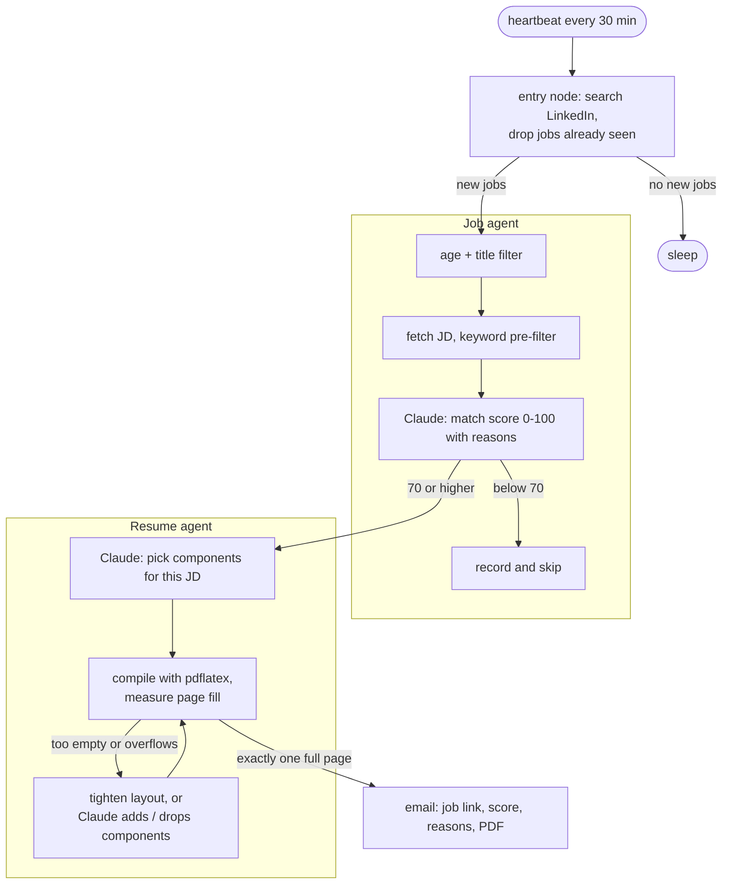

# linkedin-pulse

**An autonomous agent that monitors LinkedIn for new jobs in the background, evaluates them against your experience pool, and emails you a tailored one-page resume for every strong match.**

Job hunting usually means constantly refreshing job boards, skimming dozens of postings that turn out to want "5+ years" or a security clearance, and manually rewriting the same resume over and over. `linkedin-pulse` runs that entire loop for you on a heartbeat: every 30 minutes, it pulls the newest postings, screens them, scores them against your experience with Claude, and for every strong match, builds a custom one-page resume and sends it straight to your inbox with the job link and match breakdown. 

*(Note: Auto-applying is temporarily omitted due to LinkedIn’s strict anti-automation risk policies).*

> Demo video: _add link here_

---

## What you get

This system continuously monitors newly posted jobs on LinkedIn in the background, automatically selects and combines items from your experience pool to generate a resume tailored to the exact JD, and automatically sends an email notification with the generated resume attached to prompt your application.

```
Subject:    [Pulse 93] Software Development Engineer - 2026 (US) @ Amazon
Attachment: resume_Amazon.pdf

Software Development Engineer - 2026 (US) @ Amazon
Seattle, WA | posted 2026-10-22
https://www.linkedin.com/jobs/view/software-development-engineer-2026-us-at-amazon-4455784915

Match score: 93/100
- The candidate meets every basic qualification: multiple required programming languages,
  data structure and algorithm work, and a B.S. in Computer Science in progress.
- Experience goes well beyond the SDE-I baseline, including internships at Amazon Web
  Services and Stripe, plus cloud, CI/CD, and on-call work, so the level fits.
- No security clearance, citizenship requirement, or visa restriction appears in the
  posting, so no cap applies.

Matched: Go/Python/Java/C++, data structures and algorithms, AWS, PostgreSQL/DynamoDB, CI/CD, ...
Missing: -

Tailored resume attached.
```

## How it works



- **Job agent.** New postings pass through a multi-stage funnel ordered from cheap to expensive: free filters on age and title first, a keyword check on the job description, and finally a Claude call that scores the match from 0 to 100 while explaining why. Hard blockers (like required security clearances) cap the score immediately.
- **Resume agent.** Your profile is structured as a catalog of pre-written components or blocks stored in your experience pool. For each strong match, Claude intelligently selects the most relevant blocks, and a loop compiles the LaTeX resume, adjusting the layout until it fits **exactly one page**. Bullets are never artificially rewritten, ensuring factual integrity.
- **Delivery.** Each qualified match triggers an email containing the direct job link, score, detailed reasoning, and the compiled PDF. Every job is cached to memory, ensuring subsequent heartbeats only process fresh postings.

## Results from a real run

One heartbeat across three search queries, processing 45 new postings:

| Pipeline Stage | Jobs Count |
|---|---|
| Rejected by age/title (pre-fetch) | 17 |
| Rejected by keyword pre-filter | 4 |
| Scored below 70 by Claude | 10 |
| **Matched: tailored resume built and emailed** | **14** |

Total Claude API spend for the run, including all 14 custom resumes: **about $0.04**.

## Quick start

**Requirements:** Python 3.11+, a LaTeX distribution with `pdflatex` (macOS: `brew install --cask basictex`), and an Anthropic API key.

```bash
pip install -e .
```

```bash
cp .env.example .env
```

Insert your `ANTHROPIC_API_KEY` into `.env`, then run a single heartbeat test:

```bash
python main.py --once
```

Remove `--once` to keep the agent running in the background. Search queries, filters, score thresholds, and models are configured in `config.yaml`. 

By default, emails are written to `work/outbox/` (dry run). To send real emails, set `email.dry_run: false` and fill in your SMTP settings in `.env`.

To use your own background profile, customize the content blocks in `assets/components/` and their indexes in `assets/resume.json`.


## Team

- Yuchen Xiong
- Yinyi Liu
